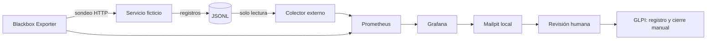

# Monitoreo y gestión del servicio del ERP de Correo Horizonte

Prueba de concepto académica de Nexo IT. Un servicio ficticio genera operaciones de admisión, seguimiento y facturación. El colector externo lee sus registros, Prometheus recoge métricas, Grafana muestra indicadores y envía avisos al buzón local Mailpit. Los incidentes se registran y cierran manualmente en GLPI.

## Iniciar

Requisitos: Docker Desktop con motor Linux, Docker Compose y PowerShell 7. La primera ejecución necesita Internet para descargar imágenes. Las siguientes pueden ejecutarse localmente sin conexión.

```powershell
./iniciar.ps1
# Esperar la instalación inicial de GLPI y después:
./configurar-glpi.ps1
./verificar.ps1
./preparar.ps1
```

La preparación dura aproximadamente cuatro minutos. Esperar su finalización y un minuto adicional en estado normal. Abrir previamente estas vistas:

| Vista | Dirección | Acceso |
|---|---|---|
| Control de escenarios | http://localhost:8000 | Local |
| Grafana | http://localhost:3000 | `admin`; clave `GRAFANA_PASSWORD` en `.env` |
| Incidentes GLPI | http://localhost:8081 | `glpi`; clave `DEMO_PASSWORD` en `.env` |
| Buzón de alertas | http://localhost:8025 | Local |

El archivo `.env` se genera en la primera ejecución y se excluye del repositorio. Conservarlo junto al entorno local. Las contraseñas se aplican al inicializar los volúmenes: editar `.env` después no modifica las claves ya almacenadas.

## Recorrido de uso

1. Mostrar estado normal y abrir **Simulación previa** desde el control. Señalar su fecha y los ejemplos de p95 superior a dos segundos y errores superiores al 1 %.
2. Seleccionar **Provocar caída**. Consultar Grafana y el correo de indisponibilidad.
3. En GLPI crear un incidente: título `[P1] ERP Correo Horizonte — indisponibilidad`, categoría `ERP Correo Horizonte`, urgencia e impacto muy altos (P1 del proyecto), técnico `Equipo TI Correo Horizonte`. Describir la alerta y registrar la primera atención.
4. Seleccionar **Restablecer servicio**. Verificar disponibilidad y correo de recuperación.
5. Registrar la solución y cerrar manualmente el ticket después de verificar el servicio.

Iniciar los servicios y abrir las sesiones de Grafana y GLPI antes de comenzar el recorrido. La preparación no crea tickets automáticamente.

## Indicadores y tiempos acelerados

| Configuración | Demostración | Referencia del informe |
|---|---|---|
| Sondeo HTTP y recolección | 5 s | 60 s para disponibilidad |
| Evaluación de Grafana | 10 s | Cada minuto para latencia y errores |
| Ventana de latencia y errores | 30 s | 5 min |
| Mínimo por tipo de operación | 20 operaciones válidas | 20 operaciones válidas |
| Latencia | p95 > 2 s | p95 > 2 s |
| Tasa de errores | > 1 % | > 1 % |
| Persistencia de latencia y errores | 20 s | 5 min |
| Caída / recuperación | 3 fallos / 2 éxitos consecutivos | 3 fallos / 2 éxitos consecutivos |
| Primera notificación / cambio del grupo | 0 s / 5 s | Configuración particular de la POC |

El colector calcula cada segundo una ventana móvil de 30 s a partir de la fecha de finalización de los registros: cantidad exacta, porcentaje de fallos y p95 por rango más próximo. También exporta contadores e histogramas para auditoría. Cada tipo de operación se evalúa por separado. Las consultas descartan ventanas con menos de 20 resultados válidos y requieren que la fuente y el colector estén disponibles. No se reemplaza dato desconocido por cero errores. Una falla del sondeador no equivale a una caída confirmada del ERP.

La confirmación de disponibilidad exige tres fallos consecutivos dentro de 15 s y dos éxitos consecutivos dentro de 10 s. Un éxito seguido de un fallo no confirma la recuperación. Grafana evalúa cada 10 s, con `for: 0s` y sin espera adicional de recuperación. La política de correo usa `group_wait: 0s`, `group_interval: 5s` y `repeat_interval: 1h`; los mensajes de resolución están habilitados. El objetivo de recepción dentro de 30 s se comprueba con ensayos, no se presume por la configuración.

La retención interna de estados resueltos (`resolved_alert_retention`) es de 10 s en esta configuración local. Evita que los reenvíos de una caída anterior retrasen el aviso de un nuevo ciclo breve. No añade espera al correo de recuperación ni modifica el intervalo de repetición de una hora.

**Simulación previa** conserva un intervalo fechado de una ejecución anterior real del simulador. **Monitoreo en vivo** muestra la actividad actual. No se simulan meses de ejecución ni se acredita cumplimiento del SLO mensual de 99,9 % o del SLA propuesto de 99,5 %.

## Arquitectura



El control y el generador están en el mismo contenedor del simulador; el colector se ejecuta en otro con el volumen de registros montado como solo lectura. El generador realiza seis solicitudes por segundo, repartidas entre las tres operaciones. En demora cada operación tarda alrededor de 3,05 s. En errores falla una de cada diez operaciones de cada tipo. En caída las solicitudes se rechazan antes de ejecutar una operación de negocio.

## Detener y volver a iniciar

```powershell
./detener.ps1
./iniciar.ps1 -SinDescargas
```

Se conservan los volúmenes con métricas, tickets, correos y configuración. El simulador vuelve a estado normal al reiniciarse. No ejecutar `down -v` si se desea conservar la evidencia.

`-SinDescargas` exige que las imágenes ya estén preparadas y utiliza `--no-build --pull never`. Las dependencias Python directas están en `requirements.txt`; `requirements.lock` fija también las transitivas utilizadas en la imagen.

## Verificación y evidencia

```powershell
./verificar.ps1
# Después de finalizar la preparación:
./auditar-historico.ps1
# Con el simulador en fase en vivo; dura varios minutos:
./ensayar-alertas.ps1
# Verificar fallas del monitoreo y volumen insuficiente:
./verificar-calidad.ps1
# Verificar operación local sin salida externa de los contenedores:
./verificar-sin-internet.ps1
```

La auditoría compara los valores conservados en Prometheus con los registros correspondientes a cada ventana. Los ciclos técnicos miden recepción de correo con diferentes desfases. Sus resultados quedan en `.evidence`, fuera de Git. La guía [docs/recorrido.md](docs/recorrido.md) contiene el recorrido y los campos del incidente; los ensayos manuales deben incluir el ticket guardado y cerrado.

La prueba sin Internet retira temporalmente la ruta externa de los ocho contenedores de esta demo y la restaura al finalizar. Conserva la red entre componentes y el acceso por localhost. Emplea la imagen de Prometheus ya descargada como herramienta auxiliar; no modifica la conectividad del equipo. Los resultados técnicos se resumen en [docs/validacion.md](docs/validacion.md).

## Problemas habituales

- **Docker no responde:** iniciar Docker Desktop y esperar que el motor Linux esté disponible.
- **Puerto ocupado:** detener el servicio que usa 8000, 3000, 8081, 8025 o 9090; comprobar antes del ensayo.
- **GLPI aún no está preparado:** consultar `docker compose -p erp-demo logs --tail 50 glpi` y repetir la configuración cuando termine su instalación.
- **Dato insuficiente:** esperar actividad normal al menos 30 s y verificar el volumen, sin interpretar el panel vacío como resultado exitoso.
- **No aparece un correo:** revisar la regla en Grafana, el contacto local y los tiempos medidos del ensayo.
- **Histórico vacío tras recrear volúmenes:** volver a ejecutar `preparar.ps1`. Los datos históricos no se inventan ni se cargan con fechas alteradas.

## Fuentes técnicas

- [Blackbox Exporter](https://github.com/prometheus/blackbox_exporter)
- [Provisionamiento de Grafana](https://grafana.com/docs/grafana/latest/administration/provisioning/)
- [Intervalo mínimo de Grafana](https://grafana.com/docs/grafana/latest/setup-grafana/configure-grafana/#min_interval)
- [Notificaciones y sus esperas](https://grafana.com/docs/grafana/latest/alerting/fundamentals/notifications/group-alert-notifications/)
- [Imágenes oficiales de GLPI](https://github.com/glpi-project/docker-images)
- [Mailpit en Docker](https://mailpit.axllent.org/docs/install/docker/)
